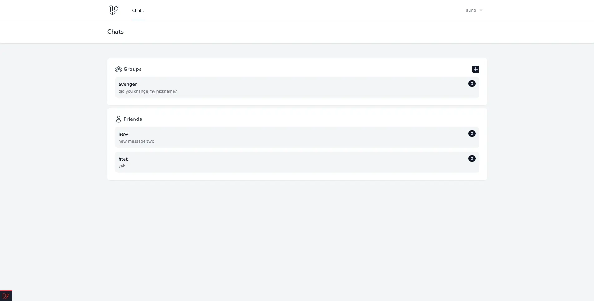

# Real-time Chat App

A chat app for one-to-one and group conversations. Messages appear right away, without a page reload. It is built with Laravel and Vue (through Inertia), and Pusher with Laravel Echo carries the live updates.



## Features

- One-to-one and group chats
- New, edited and deleted messages show up live for everyone in the chat
- Shows which members are online in a chat (Pusher presence channels)
- Marks chats that have new messages
- Add friends with a QR code or a share link, and regenerate your code
- Add friends directly while creating a group chat
- Group settings: rename the group and add or remove members
- Responsive layout for mobile

## Tech stack

- **Backend:** Laravel 9, PHP 8, MySQL, Laravel Breeze (auth), Pusher
- **Frontend:** Vue 3, Inertia.js, Laravel Echo, Tailwind CSS 3, Vite
- **Other:** `endroid/qr-code` to create QR codes

## Getting started

You need PHP 8, Composer, Node.js, MySQL and a free [Pusher Channels](https://pusher.com/channels) app.

```bash
git clone https://github.com/ahp-sooyaa/real-time-chat-app.git
cd real-time-chat-app
composer install
npm install
cp .env.example .env
php artisan key:generate
```

In `.env`, set your database, switch broadcasting to Pusher and add your Pusher keys:

```dotenv
BROADCAST_DRIVER=pusher
PUSHER_APP_ID=...
PUSHER_APP_KEY=...
PUSHER_APP_SECRET=...
PUSHER_APP_CLUSTER=...
```

Then create the tables and start the app:

```bash
php artisan migrate
npm run dev
php artisan serve
```

Open http://localhost:8000, register two accounts (one in a private window) and start chatting.

## Roadmap

- [ ] Search for people to connect with
- [ ] Notifications
- [ ] Tests

## License

[MIT](LICENSE)
